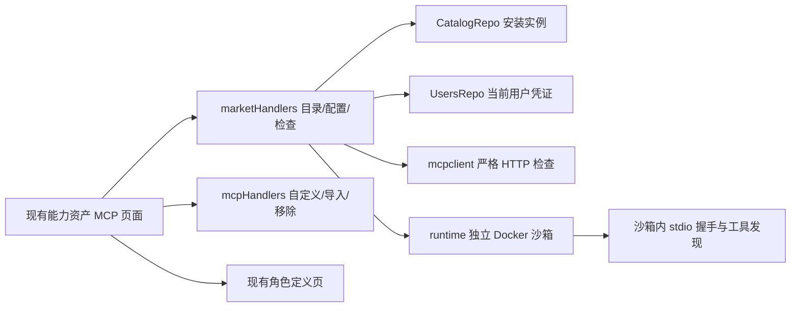

# 公共 MCP 可视化配置技术设计

版本 v1.0；2026-11-23；待实施评审。需求以 [prd.md](prd.md) 为准，源码事实见 [research.md](research.md)。下列新增结构与接口是拟定契约，尚未实现。

## 1. 架构与归属



- 内置模板仍由 `mcp_market_catalog.json` 提供；无需新增服务或注册中心。
- 安装实例仍为 `MCPServerDefinition`，由 `CatalogRepo` 持久化；`Store` 不加领域方法。
- `marketHandlers` 负责模板相关请求；`mcpHandlers` 保持自定义与既有管理职责。服务依赖在装配入口显式注入，handler 不直接接管通用 Repo 或 Worker 调度。
- 检查不创建业务 Run / Issue、不修改角色、不触发交付；受控策略仍在既有领域和运行路径执行。

## 2. 模板契约

保留既有 `id/name/description/category/tags/url/transport/authType/aliases/detailUrl/iconUrl/official` 字段，增量增加：

| 字段 | 用途 |
| --- | --- |
| `templateVersion` | 平台模板版本，变更字段或默认配置时递增 |
| `publisher`、`sourceURL`、`licenseURL` | 可核对的来源，不伪造官方背书 |
| `availability` | `ready` 或 `candidate`；仅 ready 可作为受支持模板安装 |
| `requirements` | 运行依赖、支持测试位置、准备说明 |
| `configuration` | 固定基础配置；stdio 使用分离的 command 与 args |
| `fields` | 平台维护的可填写参数列表 |

字段类型首期只实现 `text/password/directory/select`，带 `key/label/required/default/help` 和有限枚举。每个 key 由服务端代码明确映射到允许修改的 headers/env/args 等位置；不接受用户提交任意对象路径、任意启动脚本或整个 command 替换。五个模板不引入通用 Schema 渲染平台。

正式 stdio 模板固定包版本；检查使用预备镜像内依赖，不在点击检查时执行 `latest`、远端安装脚本或自动下载浏览器。未准备时返回缺依赖。

安装实例最小补充来源与模板版本快照（例如可选 `templateSource`），存入现有 JSON payload；来源、版本和旧默认配置不能仅通过当前目录反推。旧实例缺字段仍可读取，显示历史配置。

## 3. 接口契约

所有错误保留现有 `error` 文本兼容，并增量给出 `code`；不返回远端原始响应、stderr 或密钥。接口通过现有身份中间件；检查和写入显式接入按范围权限检查。

### 3.1 获取目录

`GET /api/mcp-market?q=...&category=...&transport=http|stdio`

保留 `source/fetchedAt/total/items`，增加 `filteredTotal/categories/transports`。`total` 始终为可见完整目录数，筛选数量单列。小目录由服务器提供一致筛选，前端可在完整已加载快照上即时筛选；搜索词沿用多词全部匹配语义。

目录不包含用户凭证和他人安装情况。安装状态来自用户已经有权查看的 MCP 列表，按当前范围计算。

### 3.2 添加配置

继续使用 `POST /api/mcp-market/install`：

```json
{
  "marketId": "context7",
  "templateVersion": "<目录返回的版本>",
  "scope": "project",
  "projectId": "<当前项目>",
  "name": "文档检索",
  "parameters": {"apiKey": "<本次填写的值>"},
  "timeoutSec": 30
}
```

个人范围省略 projectId，服务端从已登录用户设置 OwnerUserID，拒绝替他人指定 owner。新模板要求版本匹配，版本已变化返回 `409 TEMPLATE_VERSION_CHANGED`；旧 GitHub 安装请求不含版本 / parameters 时仍使用兼容默认值。

成功返回 `201` 与现有脱敏 MCP 对象。重复返回 `409 ALREADY_INSTALLED`，仅在调用者有权查看时包含 `existingId`。参数未知、缺必填、越界、范围冲突返回 `400`；无登录 `401`、无范围权限 `403`、模板 / 项目不存在 `404`。

### 3.3 修改已有目录配置

拟新增 `PUT /api/mcp-market/installations/:id`，请求包含 name、parameters、timeoutSec 和客户端看到的 expectedRevision。服务端先读取原实例、校验范围权限和修改版本，再按照该模板允许字段生成更新。

保留 ID、MarketID、Scope、ProjectID、OwnerUserID、来源快照与角色引用；不接受通过此接口迁移范围。掩码使用既有 `RestoreMaskedMCPSecrets` 语义；明确“未更换”和“清除密钥”两种动作。版本过期返回 `409 CONFIG_CHANGED`，避免覆盖其他人刚保存的 Key。

旧模板被移除 / 历史版本无法安全映射时提供只读、移除或另存自定义，不自动套用新版本。原有 `/api/mcp-servers` 的市场项任意修改拒绝保持有效；模板编辑通过专属接口。

### 3.4 显式检查

拟新增 `POST /api/mcp-market/check`。复用添加参数，增量接受 requestId、draftRevision、testLocation；编辑检查可携带 installationId，服务端先鉴权再读取该实例的已存密钥。

```json
{
  "requestId": "<页面生成的检查标识>",
  "draftRevision": 4,
  "status": "passed",
  "testedAt": "<服务端时间>",
  "testLocation": {"kind": "platform", "transport": "http"},
  "tools": [{"name": "<实际工具名>", "description": "<实际描述>"}],
  "code": "OK"
}
```

该示例是响应。检查请求不允许客户端指定 status / tools / testedAt；它们只能由实际结果生成。请求有效但服务检查失败仍返回 `200` 与 `status=failed`、分类 code；无可用环境返回 `status=unavailable`。格式 / 权限错误使用 4xx；平台内部错误返回 5xx。

检查同步完成，不新增后台任务队列、检查表或持久凭证。`checking` 是前端等待状态，刷新后的 `untested` 也是 UI 状态；接口只返回终态。用户取消使用 AbortController，服务端全链路使用 Request.Context。

## 4. 并发与持久化

### 安装

现有“列表去重 + upsert”不能保证首次创建语义。为目录安装新增 `CatalogRepo` 的 create-if-absent 方法，保留通用 `PutMCPServer` 对自定义配置的行为。

1. 按目录规范 ID 解析别名；项目以 projectId、个人以当前 userId 为 owner。
2. 使用既有 `mcpInstallID` 规则生成稳定 ID，维持 64 字节长度约束。
3. 先识别已有历史同范围别名实例；存在则定位它。
4. 对新实例执行数据库原子 INSERT，主键冲突只读取既有记录并返回重复；禁止 DO UPDATE。
5. 两个并发请求必须只有一次 `201`；另一次 `409`，即使填写不同 Key 也不得覆写。

目录专属编辑在短事务内按主键 SELECT FOR UPDATE，并直接使用锁定读取的 payload 核对 expectedRevision；通过后将 configurationRevision 加一并写回。旧实例缺少 revision 时按 0 处理，首次显式编辑写入 1；不做启动全表补写。不得在 MySQL RR 事务中拿普通快照 getter 替代锁定行的数据。版本不匹配返回 409，时间戳仅用于展示。以真实 MySQL 验证两个客户端编辑不会丢失更新。

不新增数据库表和启动 seed，不对旧行批量迁移。若实施发现确实必须增列或约束，先更新本设计；数据迁移只能使用 `migrations/` 下手动 SQL。

## 5. HTTP 严格检查

现有 `ensureInit()` 具有失败宽容和独立 60 秒 HTTP 超时，不能直接保证严格检查。新增小范围严格探测入口，复用序列化 / SSE 读取基础能力，旧业务调用的宽容行为先保持兼容。

- 一个 context 截止时间覆盖连接、initialize、initialized、tools/list 分页和结束阶段；用户超时仅允许 10–60 秒。
- 验证 HTTP 状态、JSON-RPC id / error、初始化结果、协商协议版本、会话头和实际 tools 内容。认证失败、RPC error、畸形响应必须失败。
- 支持响应中的 MCP Session ID、版本头，以及工具列表游标。建议首期上限 20 页 / 1000 工具 / 总响应 1 MiB；超过则显示 `RESPONSE_LIMIT`，不谎称已完整读取。
- 只访问模板允许的 HTTPS host / path，认证 header 不跟随跨域重定向；拒绝非白名单目的地。GitHub Key 不被用于 Context7 或其他主机。
- GitHub 由服务端按当前操作者读取凭证，不写静态 Authorization 回实例；错误按 AUTH_REQUIRED、AUTH_FAILED、TIMEOUT、PROTOCOL_ERROR、RESPONSE_LIMIT 分类。
- 工具描述是外部不可信文本，仅转义展示，不能作为平台命令或浏览器 HTML 执行。
- 必要的会话结束按协议尝试，失败不将业务操作触发为补救措施。

## 6. stdio 检查与资源回收

首期从平台已有 runtime Manager 创建专属临时 Docker 沙箱，复用 MCP 配置生成与沙箱内工具发现路径。不要把 `runStdioMCP` 从 HTTP handler 直接调用，因为它会在当前进程环境启动命令。

1. 检查身份 / 范围 / 模板 / Docker 能力；无能力立即 unavailable，禁止降级 native/local。
2. 预备镜像固定依赖，创建独立空工作区，Filesystem 只挂载合成文件；允许目录经规范化后必须位于本检查 `/workspace` 内，拒绝 `..`、越界符号链接和宿主路径。
3. 不挂载 Docker socket、真实仓库、用户 HOME 或真实 SSH 配置；使用独立临时 HOME 与所需最少 env。
4. 用已有 Sandbox.Exec 在容器内调用受限 MCP helper，仅执行 initialize / initialized / tools/list；不调用任何 tools/call。
5. 对现有 stdio helper 补调用 context、分页和有界输出；进程关闭后等待并回收。初始建议限制为 1 CPU、512 MiB、64 PID、单用户 1 个 / 单实例 2 个检查，繁忙返回 429。实施按现有 sandbox 资源结构落实，未生效不能宣称隔离通过。
6. 超时、断开、取消、成功、失败统一进入 cleanup。清理使用独立至多 5 秒的 context，避免原请求取消后 Close 无法执行；记录自身资源 ID，不执行全局 prune。
7. 失败日志只记检查 ID、模板、操作者、位置、阶段、时间和错误分类。stderr 截断到 64 KiB 后脱敏，不向前端透传。

远程 Runner 若尚无受支持的检查能力，不新增任务协议；前端隐藏或标记不可用。后续扩展需另有权限、资源生命周期和真实节点验收。

## 7. 前端状态与配置生命周期

- 沿用 `web/app/mcp.js`、原 HTML 和页面 CSS；必要时只拆一个选择器模块，不引入 React 或全局状态框架。
- 页面状态包含 step、query、filters、scope、projectId、selectedTemplate、draft、draftRevision、checkResult、saving。异步返回必须同时匹配页面会话、requestId、revision、scope 和模板。
- 原始密钥仅保留于当前表单内存；提交 / 范围或服务切换 / 登出后清理。返回同一配置可保留非敏感草稿；关闭期间不保留真实密钥。刷新恢复的是服务端脱敏安装配置，不恢复密钥草稿。
- 检查成功只绑定当前 draftRevision 和 testLocation。参数变化马上清除结果，编辑保存后的实例以返回 ID / UpdatedAt 关联本次展示。安装 API 不接收 passed 声明。
- 添加返回 409 刷新有权查看的列表并定位 existingId；禁止自动重试为更新。
- 目录项允许编辑声明字段；自定义项继续原表单。去角色页使用现有导航并携带有权使用的 MCP ID，页面挂载后定位，不能自动写角色。
- 主体模态 focus trap、背景 inert、Escape 与焦点恢复；页面跳转和范围切换取消待处理检查，保存期间禁用重复提交。请求断开不等于数据库事务未完成，重新进入后按服务器实际记录显示。
- 选用现有 `--hui-*`，不重新声明全局颜色。桌面 1120px 宽面板、手机近全屏；固定标题 / 操作区，中间滚动。

## 8. 安全与兼容边界

- 允许个人 MarketID 只放宽实体合法性；所有写入口仍校验用户所有权，JSON 导入不能成为伪造 owner 或市场元信息的旁路。
- 模板更新不会更改已安装参数和版本；原 aliases 继续被角色 / SOP 解析。
- 检查只证明当前平台 / 沙箱位置，不证明远程 Worker 网络、实际工具写权限或未来服务健康。
- 增加集成不改变受控交付剥离外部 MCP 的规则，不注入其他平台令牌。
- 对密钥的现有保存方式不作加密能力扩张声明；日志和公共数据继续脱敏。

## 9. 发布与回滚

先完成本地浏览器与真实检查验收，再按用户另行授权提交 / 推送 / 部署。服务端先兼容扩展目录、安装 / 修改 / 检查契约，前端最后切站内入口；前端遇旧服务器或未支持检查接口时显示不可用，不伪造通过。

回滚入口 UI 不删除安装实例或用户参数。旧二进制对新增 personal+MarketID 的写入不兼容，因此新增个人目录实例后不能只回滚后端；应采用前向修复，或先导出清单，经运维人工确认将相关个人实例转成等价自定义并保留 ID / 角色引用，再回滚。该转换不作为自动启动迁移。

检查功能临时不可用时可继续管理已有配置；保留自定义入口。回滚与降级不能偷偷重启安装脚本、覆盖密钥或自动解绑角色。
