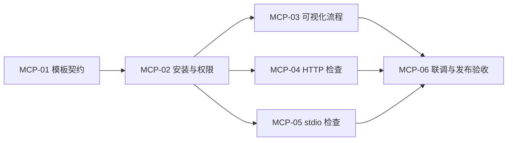

# 公共 MCP Trellis 实施计划与进度

状态：首批实现已完成。本文件保留任务拆分与未完成验收项；真实外部服务与发布证据仍需独立执行，不调用 `task.py start` 代替产品验收。

## 1. 任务与顺序

父任务 `11-23-public-mcp-visual-config` 负责集成验收，不作为第二套实现层。六个子任务的依赖如下，父子树本身不代表依赖执行器：



推荐按 MCP-01 → MCP-02 → MCP-04 → MCP-05 → MCP-03 → MCP-06 串行完成，减少前端猜测契约。此处定义依赖，不要求启用多 Agent。

### MCP-01：精选模板与参数契约

目录：`11-23-public-mcp-templates`；无前置任务。

- [ ] 逐项核对五个候选的官方来源、许可、版本、认证字段、依赖和工具发现兼容性。
- [ ] 定义小范围字段结构、模板版本、ready / candidate、允许测试位置。
- [ ] 保持 GitHub ID / alias 和旧目录响应兼容；字段到运行配置映射由服务端控制。
- [ ] 为至少一个 HTTP、一个 stdio 确定可验证环境；未通过候选不发布为 ready。

涉及 `internal/httpapi/mcp_market_catalog.json`、`mcp_market.go`，必要的模板值校验放领域包。完成证据：来源 / 版本矩阵，字段生成与非法参数测试。不得用这一步的静态检查通过宣称服务已可运行。

### MCP-02：项目 / 个人安装、修改与原子性

目录：`11-23-public-mcp-scoped-install`；依赖 MCP-01。

- [ ] 调整 `validateMCPScope` 与正反例，允许本人个人目录实例。
- [ ] 安装请求解析模板参数，服务端确定 owner；新编辑接口按存储实例鉴权并保留作用域。
- [ ] 目录首次安装使用 CatalogRepo 原子创建，不走会覆盖的 upsert；并发返回已存在。
- [ ] 原子编辑使用锁定行和单调 configurationRevision，过期 expectedRevision 返回 409。
- [ ] 保留密钥掩码、GitHub 认证语义、旧别名与文件引用。
- [ ] 所有写 / 导入入口验证不得伪造他人 owner、范围和受保护市场元信息。

涉及 `internal/domain/assets.go`、`mcp_masking.go`、`internal/repo/catalog.go`、`internal/httpapi/mcp_market.go`、`mcp.go`、`project_write_access.go`、`server.go`。完成证据：双项目 / 双用户、无权限、重复 / 并发安装与编辑、掩码保留、旧请求回归。Repo 方法仅挂 CatalogRepo。

### MCP-03：站内选择、配置与结果

目录：`11-23-public-mcp-selector-ui`；契约依赖 MCP-01 / MCP-02，最终联调需 MCP-04 / MCP-05。

- [ ] 四步面板沿用已确认线框：目录、详情、配置与检查、结果。
- [ ] 搜索 / 筛选 / 来源 / 范围状态完整；个人列表取消排除 marketId。
- [ ] 动态字段、必填定位、脱敏预览、目录项修改和已有项定位。
- [ ] draftRevision、请求取消、迟到结果丢弃、密钥清理和刷新语义完整。
- [ ] 添加成功不写角色；导航既有角色页并保持权限限制。
- [ ] 沿用 Harness 主题、图标、动效及现有自定义 / 导入入口。

涉及 `web/index.html`、`web/app/mcp.js`、`web/app/mcp.css` 与实际拥有事件绑定 / 导航的现有文件；如拆文件同步真实加载清单，不整页重构。完成证据：浏览器主流程、失败 / 空态、390px 手机、明暗主题、键盘与焦点。

### MCP-04：严格 HTTP 检查

目录：`11-23-public-mcp-http-check`；依赖 MCP-01 / MCP-02。

- [ ] 新检查入口使用当前请求 context，覆盖严格初始化、Session / 版本头、分页和结束。
- [ ] 新增 `/api/mcp-market/check`，显式范围权限；当前操作者 GitHub 凭证只用于 GitHub。
- [ ] 限制目的主机、重定向、时长和输出；返回脱敏错误分类。
- [ ] 正常与 RPC / HTTP 鉴权失败、畸形响应、空工具、分页、断开测试。
- [ ] 用至少一个真实 HTTP 候选验证，记录版本、位置、tools/list 和时间；不调用业务工具。

涉及 `internal/mcpclient/client.go`、`internal/httpapi/mcp_market.go` 或同领域新文件、装配及权限路由。旧业务握手宽容兼容策略需回归，不能无意破坏既有网关。

### MCP-05：Docker 内 stdio 检查

目录：`11-23-public-mcp-stdio-check`；依赖 MCP-01 / MCP-02。

- [ ] 核对现有 Manager / Sandbox / helper 的实际接口和镜像依赖，提供最小受支持能力。
- [ ] 独立临时 Docker 沙箱、合成工作区、固定依赖，不在 API 主机或真实项目中启动模板进程。
- [ ] 补 context / 分页 / 输出上限，执行只握手和列工具，不启用业务调用。
- [ ] 资源上限及并发限制落地；依赖缺失 / Docker 不可用如实 unavailable。
- [ ] 成功、失败、超时、取消、HTTP 断开均清理，独立清理 context 有界。
- [ ] 至少一个真实 stdio 候选提供协议与容器 / 进程回收证据。

涉及 `internal/runtime/sandbox_manager.go`、`sandbox_docker.go`、`mcp_call.go`、`mcp_provision.go`、同领域检查适配及 HTTP 显式注入。不会为此新增 Runner 任务协议。若隔离检查未通过，整项验收保持未完成，不仅上线 UI 就算结束。

### MCP-06：完整联调与可发布性

目录：`11-23-public-mcp-acceptance`；依赖 MCP-02 至 MCP-05 的证据。

- [ ] 执行 [acceptance.md](acceptance.md) 的逐项矩阵，保留失败和限制。
- [ ] 原有 GitHub、角色别名、自定义 / JSON 导入、密钥编辑和受控策略回归。
- [ ] 本地 MySQL 真实并发安装 / 修改，HTTP / stdio 真实候选验收。
- [ ] 桌面明暗 / 手机 / 键盘；来源文本转义、取消和范围切换。
- [ ] 写清实际发布模板列表、构建版本与回滚限制；未经授权不提交部署。

完成证据：验收报告 + 精确 SHA + 命令 / 环境 / 退出码 + 脱敏截图 / 协议摘要 / 资源清理记录。可发布结论必须同时满足功能、权限、真实运行和兼容条件。

## 2. 验证命令与边界

以下是实施阶段拟运行的命令，本轮未运行这些产品测试：

```bash
git diff --check
go test ./internal/domain ./internal/mcpclient ./internal/repo ./internal/httpapi ./internal/runtime -count=1
node --test webtest/tests/mcp-sops-runners.test.mjs
npm --prefix webtest test
go test ./internal/engine ./internal/runner -count=1
make test
make build
```

新增用例按行为归入已有领域测试或必要的新文件，不写仅复刻字段的测试。根目录没有 npm package，不能用虚构根目录 npm build 作为验证。

并发安装 MySQL 用独立临时容器 / schema，使用实际 `AGENTFLOW_TEST_MYSQL_DSN` 测试入口；只针对自己创建的命名资源清理，避免直接运行会删除固定名字容器的命令。Docker 与云服务的真实实验必须独立留证，单元 Mock / UI 原型不代替。

目录版本、Node / Go 工具链按实施当时实际 `go.mod`、`webtest/package.json`、本地环境核对。全量构建 / 测试在相关用例通过后运行一轮；后续只有改动或失败才重复。

## 3. 阶段评审与回滚点

| 阶段 | 进入条件 | 退出 / 回滚 |
| --- | --- | --- |
| 方案 | 需求 / 设计 / 执行 / 验收齐备、Trellis 校验通过 | 等待实施确认 |
| 模板 / 安装 | 最新方案获准、基线漂移已核对 | 不改旧数据，原 API 兼容；新个人记录使旧后端回滚受限 |
| 检查 | 范围权限 / 受限参数已通过 | 失败显示不可用，不降级主机执行 |
| UI 集成 | 后端契约可用 | 检查接口不可用有明确降级，自定义入口继续可用 |
| 发布 | 本地完整证据 + 独立发布授权 | 按 design.md 回滚，不丢配置 / 密钥 / 引用 |

首轮实现建议一个 `codex/public-mcp-visual-config` 功能分支顺序推进，避免六个子任务引入六套不一致接口；实际分支创建留到实施开始。
